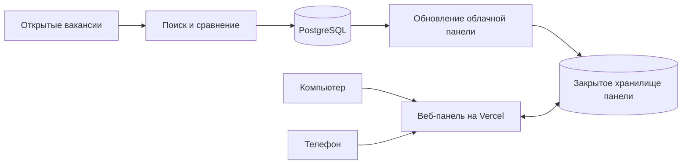

# AI Job Application Agent

Личная панель для поиска вакансий и учёта откликов. Она собирает объявления из открытых источников, сопоставляет их с подтверждённым опытом кандидата и помогает подготовить черновики CV и письма. **Отправка отклика остаётся ручным действием.**

**[Открыть веб-панель](https://ai-job-agent-panel.vercel.app/)** · [Запуск на компьютере](#запуск-на-компьютере) · [Как устроена синхронизация](#панель-и-синхронизация)

## Возможности

- Поиск вакансий на польских площадках и в выбранных открытых списках работодателей; сохранение результатов в PostgreSQL.
- Сравнение требований с фактами из закрытого профиля кандидата. Неизвестные навыки отмечаются для проверки, а не выдаются за опыт.
- Просмотр вакансий с фильтрами, ссылкой на оригинал, заметками, избранным и датой следующего действия.
- Редактируемые черновики CV и письма на польском языке, подготовленные из подтверждённых фактов.
- Журнал отправленных откликов, архив и напоминания о следующих действиях.
- Общая веб-панель для компьютера и телефона: решения и архив видны на обоих устройствах после обновления страницы. Отправленные вакансии исключаются из счётчика «В работе».

Название проекта содержит «AI», но текущая подготовка текстов основана на шаблонах и проверенных данных профиля; вызова внешней языковой модели нет. Перед отправкой нужно проверить вакансию и каждый пункт документов.

## Панель и синхронизация

Рабочая панель размещена на Vercel и защищена отдельным паролем. Пароль, личный профиль, контакты и ключи доступа не хранятся в этом репозитории. Панель открывается в обычном браузере на компьютере и смартфоне.



Отметки об отправке, заметки и даты действий сохраняются в общем хранилище, поэтому компьютер может быть выключен. Кнопка **«Обновить из базы»** пересчитывает данные панели из уже сохранённых вакансий; поиск новых объявлений запускается отдельно. Облачная панель использует также закрытый серверный компонент Sites, исходный код которого не входит в этот репозиторий. Поэтому один только этот репозиторий не разворачивает всю облачную панель.

GitHub хранит код и запускает проверки и поиск по расписанию. Рабочий адрес панели обслуживает Vercel: для неё нужны серверная авторизация и закрытое хранилище.

## Запуск на компьютере

Нужны Node.js 22.9+, pnpm и своя база PostgreSQL. Инструкции по подключению и миграциям есть в [документе о базе](docs/database.md).

```powershell
pnpm install
Copy-Item .env.example .env
New-Item -ItemType Directory -Force private | Out-Null
Copy-Item config/candidate-profile.example.json private/candidate-profile.json
```

В `.env` укажите `DATABASE_URL`, а в `private/candidate-profile.json` заполните и проверьте собственные сведения. Эти файлы исключены из Git. Затем выполните:

```powershell
pnpm profile:check
pnpm db:check
pnpm db:migrate
pnpm discover:boards
pnpm match:profile
pnpm dashboard:start
```

Локальная панель будет доступна по адресу **http://127.0.0.1:4173**. Для выбранных удалённых вакансий есть `pnpm discover:remote`. Дополнительные детали: [локальная панель](docs/local-dashboard.md), [профиль кандидата](docs/candidate-profile.md), [источники вакансий](docs/platform-sources.md), [поиск по расписанию](docs/scheduled-discovery.md).

Локальные решения сохраняются в `private/`. Облачная панель использует отдельное общее хранилище; простой запуск локальной версии не подключает её к облачному журналу.

## Проверки и безопасность

```powershell
pnpm test
pnpm typecheck
pnpm lint
```

Эти проверки запускаются также в GitHub Actions. Команда `pnpm format:check` пока показывает прежние несоответствия форматирования во многих файлах проекта и не входит в обязательные проверки. Для поиска по расписанию отдельно нужен секрет `DATABASE_URL`; без него вакансии не импортируются. Не добавляйте в репозиторий `.env`, содержимое `private/`, пароль панели, токены или готовые CV с личными данными.
